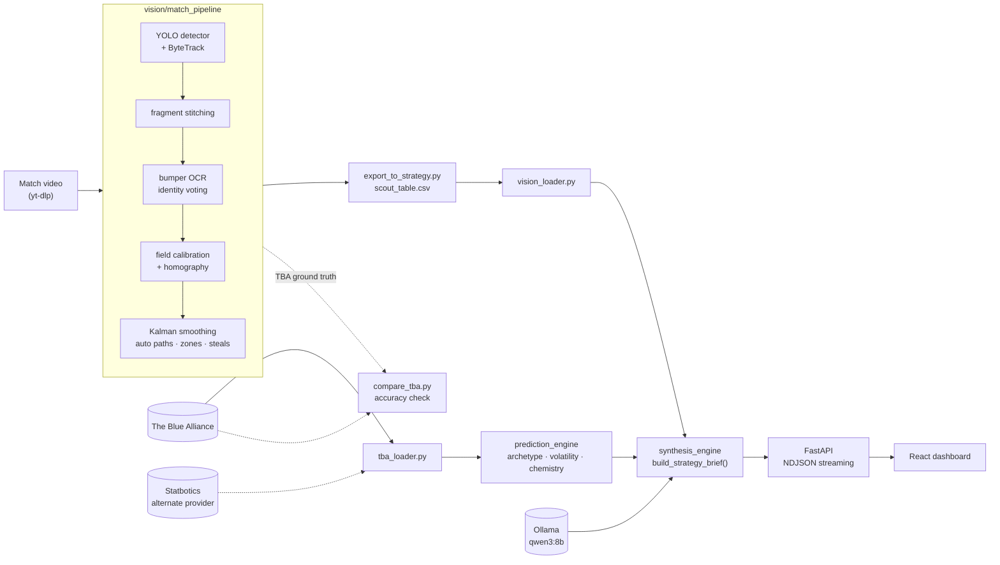

# FRC Scout AI

Measures FRC robots from match video and fuses that with The Blue Alliance into a strategy brief.

[](https://github.com/aryankhandelwal765-hash/frc-scout-ai/actions/workflows/ci.yml)

<!-- TODO(aryan): record a ~20s screen capture of an analyze run (match setup ->
     dashboard -> streaming captain read) and save it to docs/media/hero.gif. -->


## What it does

Scouting an FRC event normally means humans with clipboards watching matches and
typing what they saw. This replaces the watching half with computer vision: a
YOLO detector and ByteTrack follow every robot through the broadcast, bumper
numbers are read with OCR to work out which robot is which team, and the field
is calibrated so paths can be measured in field coordinates rather than pixels.

Those measurements are joined with The Blue Alliance's official results and OPR
aggregates, run through archetype, volatility and chemistry engines, and handed
to a local LLM that writes a strategy brief for a specific matchup. The whole
thing runs on a laptop — the model is served by Ollama, so no match data leaves
the machine.

## Architecture



## Vision pipeline

The measurement half, and the part with the interesting problems. Everything
below lives in `vision/match_pipeline/`.

### Detection and tracking

A YOLOv8 detector fine-tuned on bumper colour finds robots in each frame;
ByteTrack (`bytetrack_frc.yaml`, `trajectories.py`) links them across frames.
Alliance comes from bumper colour, not which half of the field a robot is
standing in — robots cross the field constantly, so field half is not identity.

Static field structures are the main false-positive source: the hub tower's blue
panels and the red ramps read as bumpers. `trajectories.py` builds a mask of the
static field and drops live detections that overlap it.

### Fragment stitching

ByteTrack loses a robot behind traffic and re-acquires it under a new track id.
Measured on `2026hop_qm100`: robot 1706 is read correctly off its bumper on
track 19, track 19 dies, and the later fragments get labelled by rank order — so
the same robot is 1706 for two seconds and 3035 afterwards. The read was right;
it just did not survive the id change.

`stitch.py` links fragment B to fragment A when B starts shortly after A ended,
near where A was *heading*. The gate is velocity-aware: a robot that was moving
keeps moving through the gap, so B's start is compared against A's position
extrapolated forward, and the gate widens with gap length because the
extrapolation degrades. Every distance is a fraction of the field-crop width, so
nothing breaks at a different resolution.

### Identity: OCR voting, not rank order

**Why voting beats rank order.** The obvious way to name robots is driver-station
order: TBA gives each alliance's three team keys in station order, robots line up
by station at auto start, so assign left to right. That is a guess, and it is
wrong whenever the detector misses a robot or two robots swap early. It also
fails silently — you get a confident label with no evidence behind it.

Instead, bumper numbers are read directly (`read_numbers.py`, `identify.py`).
Tesseract reads nothing on bumpers at this scale (measured 0 of 107); EasyOCR
does. Reads are noisy per frame, so they are treated as **votes** keyed by track
id, and the majority across a track wins. Because fragments are stitched first, a
read *anywhere* on a chain names the whole chain.

Frames are sampled per track rather than on a uniform stride. A uniform stride
spends its budget on whichever robot happens to be visible most and starves the
rest.

Identity is **graded**, and every robot records how it was named:

| source | meaning |
|---|---|
| `read` | bumper number actually read |
| `elim` | the only team left once the others were read |
| `rank` | left-to-right station guess, unvalidated |

Station order is the last resort, and it is labelled as such rather than being
laundered into the same confidence as a real read.

### Calibration

Three approaches were built and measured against each other: a robot-point-cloud
autofit, hand-clicked landmarks, and an AprilTag PnP solve. The canonical path
today is two phases, driven by `overnight_pipeline.py`:

1. `multi_video_apriltag_calib.py` — accumulate AprilTag observations across
   *every* video in the event and solve one ground homography. Using all videos
   rather than one is much better conditioned.
2. `fit_2d_correction.py` — fit a degree-2 polynomial correction on top, using
   robots sitting on the starting line at match start as ground truth.

Superseded calibration scripts are in `match_pipeline/_archive/` with a note on
why each lost.

### Smoothing and derived facts

`smooth_trajectories.py` runs a Kalman filter over the tracks. From smoothed
paths in field coordinates the pipeline derives auto paths and the 22 named field
zones (`zones.py`, `auto_paths.py`), a per-robot fuel split (`fuel_split.py`),
and cross-half excursions (`steals.py`).

### Validation

Two independent checks, neither needing hand labels:

- **Against TBA.** `compare_tba.py` compares the vision estimate with the
  official `score_breakdown` per alliance per match.
- **Against the rulebook.** Fully crossing the centre line during auto is a major
  foul, so a path that does is almost certainly a vision error, not a robot
  error. `validate_paths.py` turns that into an accuracy estimate.

### "Unmeasured is not zero"

The export to the strategy side (`export_to_strategy.py`) only emits columns that
are actually measured. Climb and defence are not measured by this pipeline, and a
missing value is written as missing rather than 0 — a zero would read downstream
as "this robot never climbs" instead of "we did not look". The generated scouting
notes are facts only, with no human judgement mixed in.

## Results

2026 Hopper division. 140 matches were processed; 112 produced both an
`estimate.json` and an `identity.json`. Numbers below are computed from
`examples/2026hop/report.json`, which is committed — rerun `compare_tba.py` to
reproduce them.

Vision's per-alliance ball count vs TBA's `hubScore.totalCount`:

| | alliance-pairs | matches | MAE | bias (vision − TBA) | Pearson r |
|---|---|---|---|---|---|
| All rows | 278 | 139 | 104.8 | −70.9 | 0.377 |
| Scoreboard OCR produced a reading | 245 | 123 | 37.4 | **+1.0** | **0.862** |

The gap between those rows is the headline finding. In 33 of 278 alliance-pairs
(12%) the scoreboard OCR returned nothing and the estimate is 0, which drags the
aggregate down and produces the large negative bias. Where the OCR reads at all,
correlation is 0.86 and the estimator is essentially unbiased. The failures
cluster in playoff matches (`f1m*`, `sf*`), which use a different broadcast
overlay — a known, bounded problem rather than a diffuse accuracy one.

Detection recall, and the per-identity-source accuracy table, are documented in
`vision/match_pipeline/README.md` as ~2.3 of 3 robots per alliance and
0.8 / 3.8 / 7.1% illegal-crossing rates for `read` / `elim` / `rank`.

> TODO(aryan): the committed `examples/2026hop/path_quality.csv` does not
> reproduce those crossing rates — recomputing from it gives 49.5% / 49.1% /
> 60.6% (52.1% overall, n=670). The CSV is most likely stale, from before the
> AprilTag calibration landed. Rerun `validate_paths.py` against the current
> field map and put the real numbers here. Same for the ~2.3 recall figure,
> which nothing on disk currently reproduces.

## Strategy

The decision half, in `strategy/scout/engine/`:

- **`archetype_engine`** — playstyle from the EPA breakdown: phase shares and a
  label (auto specialist, teleop workhorse, balanced contributor, …).
- **`volatility_engine`** — floor, ceiling and consistency from `epa_sd` and
  `epa_max`. A high-ceiling, low-floor robot is a different planning problem
  from a metronome with the same average.
- **`chemistry_engine`** — alliance synergy from the three archetypes: phase
  coverage, scoring overlap, and top-heaviness (one robot carrying an alliance
  is fragile).
- **`prediction_engine`** — EPA win probability plus a trained score model.
- **`synthesis_engine`** — merges the quantitative layers with vision-measured
  scoring and any scouting notes into one prompt, then streams a read from a
  local Ollama model. Variants: neutral strategy, alliance captain briefing,
  coaching for your own team, and a short per-robot read for all six.

Reads stream to the browser as NDJSON, including the model's thinking phase, so
the UI shows live progress instead of a frozen spinner.

## Quickstart

Needs Python 3.12 or 3.13 (`.python-version` pins 3.13; CI tests both), Node 24,
and [Ollama](https://ollama.com).
A free [TBA read key](https://www.thebluealliance.com/account) is required for
live data.

### Without Docker (recommended)

This is the path that is actually verified — a fresh clone was taken through it
end to end.

```bash
git clone https://github.com/aryankhandelwal765-hash/frc-scout-ai.git
cd frc-scout-ai

cp .env.example .env          # then put your TBA_AUTH_KEY in it

python3 -m venv strategy/.venv
strategy/.venv/bin/python -m pip install -r strategy/requirements.txt

ollama serve &                 # in its own terminal
ollama pull qwen3:8b

strategy/.venv/bin/python -m uvicorn scout.api.main:app --port 8000 --app-dir strategy &

npm --prefix strategy/frontend install
npm --prefix strategy/frontend run dev
```

The app is at http://localhost:5173, the API docs at http://localhost:8000/docs.
`strategy/start.sh` runs all three together.

Tests:

```bash
strategy/.venv/bin/python -m pip install -r requirements-dev.txt
strategy/.venv/bin/python -m pytest
```

### With Docker (untested)

> **Untested.** The compose file and Dockerfile have been syntax-checked only —
> Docker was not available on the machine this was prepared on, so the stack has
> never been brought up from this branch. Treat the commands below as a starting
> point, not a verified recipe. Use the non-Docker path above for a known-good
> setup.


```bash
git clone https://github.com/aryankhandelwal765-hash/frc-scout-ai.git
cd frc-scout-ai/strategy

cp ../.env.example .env       # then put your TBA_AUTH_KEY in it

npm --prefix frontend install
npm --prefix frontend run build

docker compose up -d --build
docker compose exec ollama ollama pull qwen3:8b
```

The app is at http://localhost/. Set `OLLAMA_MODEL` in `.env` to use a different
model. See [docs/deploy.md](docs/deploy.md) for the full checklist.

### Running the vision pipeline

The pipeline needs its own environment plus ffmpeg and tesseract, and match video
it downloads itself. See [vision/README.md](vision/README.md) and
[vision/match_pipeline/README.md](vision/match_pipeline/README.md).

```bash
python3 -m venv vision/venv
vision/venv/bin/python -m pip install -r vision/requirements.txt
brew install ffmpeg tesseract
```

## Repo layout

```
strategy/           FastAPI + React + LLM synthesis
  scout/engine/     archetype · volatility · chemistry · prediction · synthesis
  scout/api/        NDJSON streaming endpoints
  frontend/         React 19 dashboard
vision/
  classic/          v1 classic-CV tracker (no ML; runs on any clip)
  match_pipeline/   the production pipeline: detect, track, identify, calibrate
  *.py              YOLO detector training toolchain
examples/2026hop/   one event's real pipeline output, committed
tests/              pytest suite, no network
docs/               deployment guide and development notes
```

## Known limitations

- **Detection recall is the ceiling on everything else.** Not every robot is
  found in every frame, and nothing downstream can recover a robot that was
  never detected. See the TODO above — the currently committed figures do not
  agree and need a rerun.
- **Per-robot splits are estimates; alliance totals are checkable.** The
  scoreboard gives an exact per-alliance count. Dividing it among three robots
  is a heuristic weighted by each robot's scoring-zone activity, and it is only
  as good as the robots are separable in space. When all three are in one
  churning pile, the split is unreliable.
- **Scoring is a heuristic, not a rules engine.** The classic tracker credits a
  ball to whichever robot possessed it last before it entered a goal zone. It
  does not implement the game manual.
- **Scoreboard OCR fails on playoff broadcasts.** 12% of alliance-pairs, almost
  all playoff matches, produce no reading at all — see Results.
- **Win probability is miscalibrated.** `predict_match` calls
  `win_probability_from_diff` with `sigma=100` while OPR is on a roughly
  300-per-team scale, so probabilities peg high on lopsided matchups. This is
  deliberately left alone rather than tuned by eye; a test pins the current value
  so it cannot drift silently. Fixing it properly means normalising OPR onto an
  EPA scale in `feature_engineering.py`.
- **`rank` identities are unproven.** `ALLIANCE_ORDER` has never been validated.
  Treat every `rank`-sourced label as a guess.
- **Endgame is hard-zeroed for 2026.** Climb is worth ~nothing this season, so
  `tba_loader._phase_points` returns 0 for it and the prompts refuse to discuss
  it. That is a season-specific rule, not a general one.

## Roadmap

- Normalise OPR onto the EPA scale and retune the win-probability sigma against
  held-out matches.
- Handle the playoff broadcast overlay so scoreboard OCR stops failing on `sf*`
  and `f*` matches.
- Validate `ALLIANCE_ORDER` so `rank` identities carry a real error bar.
- Move the render queue off the in-process worker pool onto something that
  survives an API restart.

## License

MIT — see [LICENSE](LICENSE).
